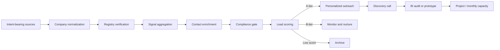
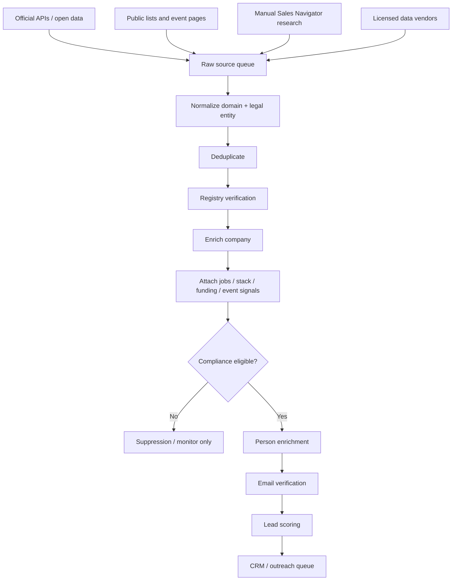
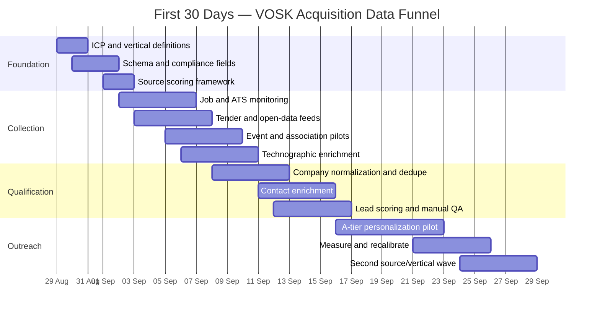
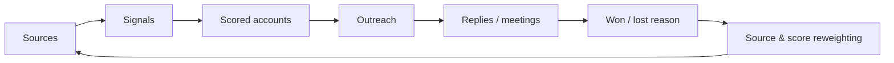

# Building the First Acquisition Funnel for VOSK BI/AI Services

## Executive summary

VOSK is positioned as a full-stack BI consultancy rather than a narrow dashboard freelancer: the site explicitly covers Microsoft Fabric, Power BI and Apache Superset, from extraction and data quality through reporting, automation, analytics and architecture, with both project and recurring-capacity commercial models. Its public work also demonstrates operational dashboarding rather than purely marketing analytics. citeturn1view0turn2view0turn2view1

That positioning materially changes how the first acquisition funnel should be built. The optimal strategy is **signal-first account sourcing**, not buying a large generic SME list. Start with evidence that an organization has a current analytics problem—BI/data hiring, ERP/CRM complexity, a procurement notice, expansion/funding, event participation, or a visible technology transition—then identify the company, verify its size and legal entity, enrich likely buyers, pass it through a jurisdiction-specific compliance gate, and only then launch personalized outreach.

The recommended funnel is:



For VOSK, the **highest-priority acquisition sources are job postings, LinkedIn Sales Navigator/Crunchbase/Wellfound, technographic and stack proxies, exhibitor/sponsor lists, and trade/chamber membership ecosystems**. Job postings are especially useful because Greenhouse and Lever expose structured public job feeds/API-style endpoints, making them far easier to monitor compliantly than scraping social networks. LinkedIn, by contrast, expressly restricts automated scraping, so Sales Navigator should be treated as a paid/manual research layer rather than a crawler target. Crunchbase provides official search/API capabilities and filters over companies, funding, geography and related firmographics. citeturn12search3turn12search23turn3search0turn3search1turn3search2turn3search18

The strongest practical ICP is narrower than “all SMEs.” In Europe, the formal EU SME ceiling is fewer than 250 employees plus financial thresholds; Canada defines SMEs as businesses with 1–499 paid employees, while U.S. small-business thresholds vary by industry. citeturn21search0turn21search2turn21search4 For acquisition, I would operationalize VOSK's core ICP as roughly:

| Segment | Recommended operational band | Highest-value signals |
|---|---:|---|
| Europe | 20–249 employees | Power BI/Microsoft hiring, ERP/CRM fragmentation, Excel-heavy finance/operations, expansion, e-commerce/logistics complexity |
| US | 20–500 employees, with industry-size check where relevant | BI/data hiring, Dynamics/NetSuite/Salesforce/Shopify stack, PE/funding/growth, multi-location operations |
| Canada | 20–499 employees | Same, with greater restraint on unsolicited email because CASL is materially stricter |
| UAE | 20–500 employees | Multi-entity reporting, ERP/CRM integrations, hospitality/retail/logistics/construction/manufacturing growth, procurement activity |

The **most attractive vertical hypotheses** for the first VOSK funnel are manufacturing/distribution, logistics, retail/e-commerce, construction/project businesses, hospitality, and multi-system professional/service businesses. This is an inference from VOSK's end-to-end reporting/ETL proposition and demonstrated operational dashboard work, rather than a claim that these are the site's existing vertical specializations. citeturn2view0turn2view1

A practical source strategy is therefore:

1. Generate candidate accounts from **fresh intent sources**.
2. Cross-check companies against **registries/directories**.
3. Add stack, hiring, growth and event signals.
4. Enrich only high-potential accounts with decision-maker data.
5. Score before outreach.
6. Keep a full provenance trail so that every contact can be traced back to a source and compliance rationale.

The large source atlas below contains **ten specific sources for each requested category in each target region—360 source-region combinations in total**. “Coverage” is my qualitative estimate of usefulness for SME acquisition, not a publisher-provided metric. Access codes mean: **Manual** = browser/research workflow; **Scrape\*** = public pages that may be technically collected only after checking robots.txt, terms and applicable law; **API** = official or licensed programmatic access; **Paid** = subscription/export/data license.

## Acquisition thesis and category priorities

The crucial distinction is between a **lead source** and an **enrichment source**. A registry can tell you that a business exists; it rarely tells you that the business needs Power BI this month. Conversely, a job posting for “Power BI Developer” tells you something about timing but may not supply revenue, ownership or a buyer's email. Combining independent signals is much more valuable than maximizing raw list size.

For VOSK, the recommended priority order is:

| Category | Intent | SME density | Freshness | Automation potential | Funnel role | Priority |
|---|---:|---:|---:|---:|---|---|
| Job postings indicating BI/AI hiring | 5/5 | 4/5 | 5/5 | 5/5 | Direct need/timing | **A** |
| LinkedIn / Crunchbase / Wellfound | 4/5 | 4/5 | 4/5 | 3/5 | ICP + decision makers + growth | **A** |
| Technology-stack directories | 4/5 | 4/5 | 4/5 | 4/5 | Stack/complexity signal | **A** |
| Conference/exhibitor/sponsor lists | 4/5 | 4/5 | 4/5 | 3/5 | Active/growing company discovery | **A** |
| Trade associations/chambers | 3/5 | 5/5 | 3/5 | 2/5 | High-trust SME universe | **B+** |
| Reseller/consultant partner lists | 4/5 | 3/5 | 3/5 | 3/5 | Referral/subcontract/channel | **B+** |
| Procurement/tender portals | 5/5 | 2/5 | 5/5 | 5/5 | Explicit projects + supplier signals | **B+** |
| Industry directories | 2/5 | 5/5 | 3/5 | 3/5 | Broad account discovery | **B** |
| Review sites | 3/5 | 3/5 | 3/5 | 2/5 | Pain/stack evidence | **B** |
| Sector/SaaS marketplaces | 3/5 | 4/5 | 3/5 | 3/5 | Installed-stack ecosystem | **B** |
| Local business registries | 1/5 | 5/5 | 3/5 | 4/5 | Verification/deduplication | **C+** |
| Data brokers | 1/5 | 4/5 | 4/5 | 5/5 | Contact/firmographic enrichment | **C as source; A as enrichment** |

This ranking deliberately pushes data brokers downward as an *origin* of leads. Apollo, Cognism, ZoomInfo, Lusha, People Data Labs and D&B are valuable ways to enrich a lead once a reason to contact the company exists; using them as the sole source of “every CFO at 50–200-person companies” creates a low-context funnel and increases both waste and privacy risk. Apollo currently advertises hundreds of millions of contacts and tens of millions of companies; D&B Hoovers and Creditsafe similarly operate very large global company datasets, while People Data Labs exposes explicit company/person enrichment APIs. citeturn16search0turn17search1turn17search2turn16search6

The same logic applies to technographics. BuiltWith and Wappalyzer can identify public-facing technologies and provide prospecting/enrichment products, but **internal Power BI/Fabric adoption is frequently invisible from the public website**. Therefore, treat Microsoft 365/Azure/Dynamics, NetSuite, Salesforce, Shopify, HubSpot, Odoo, warehouse/cloud technologies and data-role hiring as *proxy signals*, then confirm through jobs, employee profiles, case studies or conversations. citeturn13search0turn13search3

Trade and chamber ecosystems are unusually valuable for SME acquisition. Eurochambres represents a network spanning millions of European businesses with SMEs dominant in that population; SMEunited brings together SME organizations across numerous European countries. In the UAE, Dubai and Abu Dhabi chambers organize business councils/groups that provide a much cleaner business universe than indiscriminate web directories. citeturn8search0turn8search19turn8search10turn8search17

## Regional source atlas

**Industry directories — priority B.** Europages reports a supplier base in the millions, Kompass operates a global B2B directory across many countries and sectors, and Thomasnet reports more than 500,000 North American suppliers. Canada's government also maintains an official company-directory entry point. These are high-volume sources, but the strongest workflow is to pull accounts from a relevant niche and then add intent elsewhere. citeturn7search0turn7search4turn7search5turn7search1

| Region | Ten high-value sources |
|---|---|
| **Europe** | **Europages** — https://www.europages.com/ — broad European supplier/manufacturer universe; **H; Manual/Scrape\*/Paid**.<br>**Kompass** — https://www.kompass.com/ — sector, geography and company classification; **H; Manual/Paid**.<br>**wlw / Wer liefert was** — https://www.wlw.de/ — strong DACH industrial/B2B discovery; **H in DACH; Manual/Paid**.<br>**IndustryStock** — https://www.industrystock.com/ — industrial/manufacturing suppliers; **M-H; Manual/Scrape\***.<br>**Dealroom** — https://dealroom.co/ — growth/technology companies; **M; Manual/Paid/API**.<br>**EU-Startups Database** — https://www.eu-startups.com/directory/ — European startups and scaleups; **M; Manual**.<br>**F6S Companies** — https://www.f6s.com/companies — startup/SME ecosystem; **M; Manual**.<br>**Yell UK** — https://www.yell.com/ — local UK SMEs by sector/location; **H UK; Manual/Scrape\***.<br>**Cylex** — https://www.cylex-international.com/ — local-business discovery across European markets; **H; Manual/Scrape\***.<br>**Swissfirms** — https://www.swissfirms.ch/ — Swiss B2B company discovery; **M-H Switzerland; Manual**. |
| **US + Canada** | **Thomasnet** — https://www.thomasnet.com/ — particularly strong manufacturing/distribution supplier universe; **H; Manual/Paid**.<br>**IndustryNet** — https://www.industrynet.com/ — U.S. industrial companies; **H industrial; Manual/Paid**.<br>**Manta** — https://www.manta.com/ — broad U.S. small-business directory; **H; Manual/Paid**.<br>**Canadian Company Capabilities** — https://ised-isde.canada.ca/site/canadian-company-capabilities/en — government-backed Canadian supplier/company discovery; **H; Manual**.<br>**Directories of Canadian Companies** — https://ised-isde.canada.ca/site/canadian-company-capabilities/en/directories-canadian-companies — government directory hub; **H; Manual**.<br>**YellowPages Canada** — https://www.yellowpages.ca/ — local SME discovery; **H; Manual/Scrape\***.<br>**Kompass North America** — https://www.kompass.com/ — B2B company classifications; **H; Manual/Paid**.<br>**MacRAE's Blue Book** — https://www.macraesbluebook.com/ — North American industrial suppliers; **M-H; Manual**.<br>**Maker's Row** — https://makersrow.com/ — manufacturers/suppliers; **M; Manual/Paid**.<br>**IndustrySelect** — https://www.industryselect.com/ — U.S. manufacturing database; **H industrial; Paid**. |
| **UAE** | **Kompass UAE** — https://ae.kompass.com/ — structured B2B directory; **M-H; Manual/Paid**.<br>**UAECompanies.ae** — https://www.uaecompanies.ae/ — UAE company discovery; **H; Manual/Scrape\***.<br>**Yellow Pages UAE** — https://www.yellowpages-uae.com/ — local-sector coverage; **H; Manual/Scrape\***.<br>**ReachUAE** — https://www.reachuae.com/ — suppliers/traders/manufacturers; **H industrial/trade; Manual/Scrape\***.<br>**Connect.ae** — https://connect.ae/ — local businesses across emirates; **H; Manual/Scrape\***.<br>**Yello UAE** — https://www.yello.ae/ — broad business directory; **M-H; Manual/Scrape\***.<br>**ATN Info** — https://www.atninfo.com/ — industrial/business listings; **H; Manual/Scrape\***.<br>**UAE Local** — https://uae.arablocal.com/ — SME discovery; **M; Manual/Scrape\***.<br>**Emirates Business Directory** — https://emiratesbd.ae/ — local company listings; **M; Manual/Scrape\***.<br>**UAE Business Directory** — https://www.uaebusinessdirectory.com/ — additional discovery layer; **M; Manual/Scrape\***. |

Use third-party UAE directories as discovery only; verify entities against official licensing/registry sources before outreach. The UAE government provides a business-license verification pathway and the National Economic Register. citeturn10search2turn10search5

**Trade associations and chamber ecosystems — priority B+.** These sources trade breadth for trust. They are particularly good for building vertical lists—retailers, manufacturers, hotels, freight companies, construction firms—without starting from anonymous broker data. Eurochambres, BusinessEurope and SMEunited provide gateways to national and regional member organizations; the Canadian and U.S. associations below similarly aggregate businesses by industry. citeturn8search33turn8search20turn8search13

| Region | Ten high-value sources |
|---|---|
| **Europe** | **SMEunited** — https://www.smeunited.eu/ — national SME organizations; **H SME relevance; Manual**.<br>**Eurochambres** — https://www.eurochambres.eu/ — route into national/local chambers; **H; Manual**.<br>**BusinessEurope** — https://www.businesseurope.eu/ — national business federations; **M-H; Manual**.<br>**Enterprise Europe Network** — https://een.ec.europa.eu/ — innovation/export-oriented SMEs; **H; Manual**.<br>**EuroCommerce** — https://www.eurocommerce.eu/ — retail/wholesale ecosystem; **H vertical; Manual**.<br>**Orgalim** — https://orgalim.eu/ — technology/manufacturing industries; **H vertical; Manual**.<br>**DIGITALEUROPE** — https://www.digitaleurope.org/ — digital/technology companies and national associations; **M; Manual**.<br>**HOTREC** — https://www.hotrec.eu/ — hospitality associations; **H hospitality; Manual**.<br>**CLECAT** — https://www.clecat.org/ — freight forwarding/logistics/customs; **H logistics; Manual**.<br>**FIEC** — https://www.fiec.eu/ — European construction industry; **H construction; Manual**. |
| **US + Canada** | **NFIB** — https://www.nfib.com/ — U.S. small-business universe; **H; Manual/Paid membership**.<br>**U.S. Chamber of Commerce** — https://www.uschamber.com/ — route to state/local chambers; **H; Manual**.<br>**National Association of Manufacturers** — https://nam.org/ — U.S. manufacturers; **H vertical; Manual**.<br>**National Retail Federation** — https://nrf.com/ — retailers and technology ecosystem; **H vertical; Manual**.<br>**National Association of Wholesaler-Distributors** — https://www.naw.org/ — distribution companies; **H vertical; Manual**.<br>**MHI** — https://www.mhi.org/ — supply-chain/logistics/material-handling firms; **H vertical; Manual**.<br>**Canadian Chamber of Commerce** — https://chamber.ca/ — Canadian chamber network; **H; Manual**.<br>**CFIB** — https://www.cfib-fcei.ca/ — Canadian independent businesses; **H SME relevance; Manual/Paid membership**.<br>**Canadian Manufacturers & Exporters** — https://cme-mec.ca/ — manufacturing/export firms; **H vertical; Manual**.<br>**Retail Council of Canada** — https://www.retailcouncil.org/ — retailers and commerce ecosystem; **H vertical; Manual**. |
| **UAE** | **UAE Chambers / Federation** — https://www.uaechambers.com/ — national chamber gateway; **H; Manual**. citeturn23search16<br>**Dubai Chambers** — https://www.dubaichambers.com/ — business groups/councils and member ecosystem; **H; Manual**.<br>**Abu Dhabi Chamber** — https://www.abudhabichamber.ae/ — major private-sector network; **H; Manual**.<br>**Sharjah Chamber** — https://sharjah.gov.ae/ — large Sharjah company/member base; **H; Manual**. citeturn23search13<br>**RAK Chamber** — https://www.rakchamber.ae/ — Ras Al Khaimah businesses; **H locally; Manual**. citeturn23search3<br>**Ajman Chamber** — https://www.ajmanchamber.ae/en/ — includes commercial/business search routes; **H locally; Manual**. citeturn23search2turn23search10<br>**German Emirati Joint Council / AHK** — https://vae.ahk.de/ — internationally oriented UAE firms; **M-H; Manual**.<br>**British Business Group Dubai & Northern Emirates** — https://bbgdubai.org/ — English-speaking business network; **M-H; Manual/Paid membership**.<br>**Canadian Business Council Dubai** — https://www.cbc-dubai.com/ — Canadian/UAE business community; **M; Manual**.<br>**ICC UAE** — https://iccuae.com/ — internationally active businesses; **M; Manual**. |

**LinkedIn, Crunchbase, Wellfound and adjacent company-intelligence sources — priority A.** Sales Navigator exposes company headcount, geography, industry and related account/lead filters; Crunchbase supports structured organization searches and an API; Wellfound supports startup-company/job filtering, including employee count and investment stage. citeturn3search1turn3search9turn3search2turn3search15

| Region | Ten high-value sources |
|---|---|
| **Europe** | **LinkedIn Sales Navigator** — https://www.linkedin.com/sales/ — account + buyer identification; **H; Manual/Paid**.<br>**Crunchbase** — https://www.crunchbase.com/ — funding, growth and company filters; **M-H growth SMEs; Paid/API**.<br>**Wellfound** — https://wellfound.com/ — startup hiring/company signals; **M; Manual**.<br>**Dealroom** — https://dealroom.co/ — particularly strong European tech/growth ecosystems; **M; Paid/API**.<br>**F6S** — https://www.f6s.com/companies — accelerator/startup companies; **M; Manual**.<br>**EU-Startups** — https://www.eu-startups.com/directory/ — European startup discovery; **M; Manual**.<br>**Beauhurst** — https://www.beauhurst.com/ — detailed UK private-company/growth data; **M-H UK; Paid**.<br>**PitchBook** — https://pitchbook.com/ — funded/private companies; **M; Paid/API**.<br>**Tracxn** — https://tracxn.com/ — private tech-company taxonomy; **M; Paid**.<br>**StartUs Insights** — https://www.startus-insights.com/ — startup/technology discovery; **M; Paid**. |
| **US + Canada** | **LinkedIn Sales Navigator** — https://www.linkedin.com/sales/ — firmographic/buyer search; **H; Manual/Paid**.<br>**Crunchbase** — https://www.crunchbase.com/ — funding and growth; **H growth firms; Paid/API**.<br>**Wellfound** — https://wellfound.com/ — startup jobs and company pages; **M-H; Manual**.<br>**PitchBook** — https://pitchbook.com/ — private markets/funded companies; **M; Paid/API**.<br>**CB Insights** — https://www.cbinsights.com/ — growth/technology intelligence; **M; Paid**.<br>**Tracxn** — https://tracxn.com/ — private-company intelligence; **M; Paid**.<br>**Y Combinator Companies** — https://www.ycombinator.com/companies — venture-backed SMEs/startups; **M; Manual**.<br>**Techstars Portfolio** — https://www.techstars.com/portfolio — accelerator-backed companies; **M; Manual**.<br>**Built In Companies** — https://builtin.com/companies — technology employers by market; **M; Manual**.<br>**F6S** — https://www.f6s.com/companies — startup discovery; **M; Manual**. |
| **UAE** | **LinkedIn Sales Navigator** — https://www.linkedin.com/sales/ — strongest general buyer/account layer; **H; Manual/Paid**.<br>**Crunchbase** — https://www.crunchbase.com/ — funded UAE/growth companies; **M; Paid/API**.<br>**Wellfound** — https://wellfound.com/ — startup hiring; **M-L locally; Manual**.<br>**MAGNiTT** — https://magnitt.com/ — MENA startup/funding ecosystem; **H for growth SMEs; Paid**.<br>**Hub71** — https://www.hub71.com/startups — Abu Dhabi startup ecosystem; **M; Manual**.<br>**in5** — https://infive.ae/ — Dubai startup/innovation companies; **M; Manual**.<br>**DIFC Innovation Hub** — https://www.innovationhub.difc.ae/ — fintech/innovation companies; **M; Manual**.<br>**Sheraa** — https://sheraa.ae/ — Sharjah entrepreneurship portfolio; **M; Manual**.<br>**Flat6Labs portfolio** — https://flat6labs.com/portfolio/ — MENA startups including UAE-relevant firms; **M; Manual**.<br>**Dubai Future District Fund** — https://dfdf.vc/ — portfolio/growth ecosystem; **M; Manual**. |

**Local business registries — priority C+ for acquisition, A for verification.** EU BRIS links national business registers; Companies House provides free UK company information including filings and officers; Canada provides federal and cross-jurisdiction registry routes; UAE government services enable license verification. citeturn10search0turn10search3turn10search1turn10search4turn10search2

| Region | Ten high-value sources |
|---|---|
| **Europe** | **EU BRIS / e-Justice Business Registers** — https://e-justice.europa.eu/topics/registers-business-insolvency-land/business-registers-search-company-eu_en — cross-border verification; **H; Manual**.<br>**UK Companies House** — https://find-and-update.company-information.service.gov.uk/ — accounts/officers/filings; **H UK; Manual/API**.<br>**France INPI Data** — https://data.inpi.fr/ — French company/legal data; **H France; Manual/open data**.<br>**Netherlands KVK** — https://www.kvk.nl/zoeken/ — Dutch registered companies; **H Netherlands; Manual/Paid data**.<br>**Germany Unternehmensregister** — https://www.unternehmensregister.de/ — legal/financial disclosures; **H Germany; Manual**.<br>**Belgium KBO Public Search** — https://kbopub.economie.fgov.be/ — Belgian companies; **H Belgium; Manual/open data**.<br>**Denmark CVR** — https://datacvr.virk.dk/ — Danish company register; **H Denmark; Manual/open data**.<br>**Ireland CRO** — https://core.cro.ie/ — Irish company registry; **H Ireland; Manual/Paid documents**.<br>**Spain Registradores** — https://www.registradores.org/ — Spanish registry access; **H Spain; Manual/Paid**.<br>**Poland KRS** — https://ekrs.ms.gov.pl/ — Polish registered entities; **H Poland; Manual**. |
| **US + Canada** | **SEC EDGAR** — https://www.sec.gov/edgar/search/ — lower SME coverage but high-quality filings for qualifying issuers; **L-M SME; Manual/API**.<br>**Delaware Entity Search** — https://icis.corp.delaware.gov/ecorp/entitysearch/namesearch.aspx — entity verification; **H legal entities; Manual**.<br>**California bizfile** — https://bizfileonline.sos.ca.gov/search/business — California entities; **H; Manual**.<br>**New York Corporation Search** — https://apps.dos.ny.gov/publicInquiry/ — NY entities; **H; Manual**.<br>**Florida Sunbiz** — https://search.sunbiz.org/Inquiry/CorporationSearch/ByName — Florida entities; **H; Manual**.<br>**Texas SOSDirect** — https://direct.sos.state.tx.us/ — Texas entity records; **H; Manual/Paid**.<br>**Canada's Business Registries** — https://ised-isde.canada.ca/site/canadas-business-registries/en — cross-jurisdiction search; **H Canada; Manual**.<br>**Corporations Canada** — https://ised-isde.canada.ca/cc/lgcy/fdrlCrpSrch.html — federal corporations; **H federal; Manual**.<br>**Ontario Business Registry** — https://www.ontario.ca/page/ontario-business-registry — Ontario entities; **H; Manual**.<br>**Québec Registraire des entreprises** — https://www.registreentreprises.gouv.qc.ca/ — Québec company data; **H; Manual**. |
| **UAE** | **UAE business-licence verification hub** — https://u.ae/en/information-and-services/business/important-digital-services/verify-business-licences — official verification gateway; **H; Manual**.<br>**National Economic Register** — https://ner.economy.ae/ — federal company/license information; **H; Manual**.<br>**Invest in Dubai licence search** — https://app.invest.dubai.ae/search-license — Dubai mainland verification; **H Dubai; Manual**.<br>**Abu Dhabi ADDED/TAMM** — https://www.added.gov.ae/ — Abu Dhabi economic-license ecosystem; **H Abu Dhabi; Manual**.<br>**DMCC public/business directory** — https://dmcc.ae/ — free-zone company validation; **H DMCC; Manual**.<br>**DIFC Public Register** — https://www.difc.com/public-register — DIFC entities; **H DIFC; Manual**.<br>**ADGM Public Registers** — https://www.adgm.com/registration-authority/public-registers — ADGM entities; **H ADGM; Manual**.<br>**Sharjah SEDD** — https://sedd.ae/ — Sharjah licence/business verification; **H Sharjah; Manual**.<br>**Ajman DED** — https://www.ajmanded.ae/ — Ajman entities; **H locally; Manual**.<br>**RAK DED** — https://ded.rak.ae/ — Ras Al Khaimah entities; **H locally; Manual**. |

DMCC alone states that its ecosystem contains tens of thousands of businesses, illustrating why free-zone registers can be particularly efficient account universes. citeturn10search21

**Procurement and tender portals — priority B+.** For VOSK, these serve two distinct purposes: finding actual data/analytics procurements, and finding *businesses repeatedly winning contracts*, which often creates reporting, resource-planning and operational-control complexity. TED has official API/open-data mechanisms; SAM.gov supports structured federal opportunities/data access; CanadaBuys is the federal Canadian procurement hub; UAE federal and emirate-level portals publish opportunities. citeturn9search0turn9search3turn9search5turn9search13turn9search1turn9search2

| Region | Ten high-value sources |
|---|---|
| **Europe** | **TED** — https://ted.europa.eu/ — EU-wide notices, awards and buyer/supplier intelligence; **M direct SME buyers / H signal; Manual/API/open data**.<br>**UK Find a Tender** — https://www.find-tender.service.gov.uk/ — UK higher-value procurement; **M; Manual/Scrape\***.<br>**UK Contracts Finder** — https://www.contractsfinder.service.gov.uk/ — especially useful for lower-value UK opportunities; **M-H; Manual/API/open data**.<br>**France BOAMP** — https://www.boamp.fr/ — French public tenders; **M; Manual**.<br>**TenderNed** — https://www.tenderned.nl/ — Netherlands procurement; **M; Manual/open data**.<br>**Germany e-Vergabe** — https://www.evergabe-online.de/ — German federal opportunities; **M; Manual**.<br>**Ireland eTenders** — https://www.etenders.gov.ie/ — Irish public procurement; **M; Manual**.<br>**Norway Doffin** — https://www.doffin.no/ — Norwegian tenders; **M; Manual**.<br>**Denmark Udbud.dk** — https://udbud.dk/ — Danish tenders; **M; Manual**.<br>**Portugal BASE** — https://www.base.gov.pt/Base4/en/ — contract/tender information; **M; Manual/open data**. |
| **US + Canada** | **SAM.gov Contract Opportunities** — https://sam.gov/content/opportunities — U.S. federal opportunities; **M; Manual/API**.<br>**USASpending** — https://www.usaspending.gov/ — awards/supplier intelligence; **H signal; API/open data**.<br>**California Cal eProcure** — https://caleprocure.ca.gov/ — California procurement; **M; Manual**.<br>**New York State Contract Reporter** — https://www.nyscr.ny.gov/ — NY opportunities; **M; Manual**.<br>**Texas ESBD** — https://www.txsmartbuy.gov/esbd — Texas bids; **M; Manual**.<br>**CanadaBuys** — https://canadabuys.canada.ca/ — Canadian federal procurement; **M; Manual/open data**.<br>**Ontario Tenders Portal** — https://ontariotenders.app.jaggaer.com/ — Ontario procurement; **M; Manual**.<br>**BC Bid** — https://bcbid.gov.bc.ca/ — British Columbia procurement; **M; Manual**.<br>**Alberta Purchasing Connection** — https://purchasing.alberta.ca/ — Alberta opportunities; **M; Manual**.<br>**MERX** — https://www.merx.com/ — multi-jurisdiction Canadian opportunity aggregation; **M; Paid/Manual**. |
| **UAE** | **Ministry of Finance Current Business Opportunities** — https://mof.gov.ae/en/public-finance/government-procurement/current-business-opportunities/ — federal procurement; **M; Manual**.<br>**Abu Dhabi Government Procurement Gate** — https://www.adgpg.gov.ae/ — Abu Dhabi opportunities/suppliers; **M; Manual**.<br>**Dubai eSupply** — https://esupply.dubai.gov.ae/ — Dubai government procurement; **M; Manual**.<br>**DEWA Open Tenders** — https://www.dewa.gov.ae/en/supplier/main-services/open-tender — active utility procurement; **M; Manual**. DEWA explicitly supports viewing and participating in tenders online. citeturn20search4<br>**ADNOC Supplier Hub** — https://supplierhub.adnoc.ae/ — sourcing/prequalification ecosystem; **M-H supplier universe; Manual/portal**. citeturn20search5<br>**Etihad Rail Procurement** — https://corporate.etihadrail.ae/en/about/procurement — contractors/consultants/suppliers; **M; Manual**. citeturn20search2<br>**Emirates Health Services procurement** — https://www.ehs.gov.ae/en/services/purchases-system — healthcare tenders; **M; Manual**. citeturn20search3<br>**EtihadWE supplier portal** — https://srm.etihadwe.ae/vendor_register — tender/vendor participation; **M; portal**. citeturn22search0<br>**SEWA supplier/Ariba ecosystem** — https://www.sewa.gov.ae/ — Sharjah sourcing; **M; portal**. citeturn22search4<br>**Dubai Airports Suppliers** — https://dubaiairports.ae/corporate/business-opportunities/suppliers — sourcing/tender registration; **M; portal**. citeturn22search2 |

Do not restrict tender keyword monitoring to `"Power BI"`. Better terms include `business intelligence`, `management information system`, `MIS`, `dashboard`, `data warehouse`, `data platform`, `reporting`, `analytics`, `data visualization`, `ETL`, `data integration`, `Microsoft Fabric`, `Power BI`, `decision support`, `KPI`, and `performance management`.

**Conference, exhibition, meetup, sponsor and exhibitor sources — priority A.** Exhibitors and sponsors are frequently better than attendees: they are public, company-level rather than personal data, and spending on an exhibition is a useful—though imperfect—signal of commercial activity. Hannover Messe exposes an exhibitor index; IMTS, FABTECH Canada, Gulfood and Big 5 similarly publish exhibitor ecosystems. citeturn11search16turn11search21turn11search28turn11search2turn11search14

| Region | Ten high-value sources |
|---|---|
| **Europe** | **HANNOVER MESSE** — https://www.hannovermesse.de/ — manufacturing/industrial technology exhibitors; **H target fit; Manual/Scrape\***.<br>**LogiMAT** — https://www.logimat-messe.de/en — logistics/intralogistics companies; **H; Manual**.<br>**Shoptalk Europe** — https://shoptalkeurope.com/ — retail/e-commerce sponsors/exhibitors; **H; Manual**.<br>**VivaTech** — https://vivatechnology.com/ — technology/startup/corporate ecosystem; **M-H; Manual**.<br>**Web Summit Lisbon** — https://websummit.com/ — startups/scaleups/partners; **M-H; Manual**.<br>**SaaStock** — https://www.saastock.com/ — SaaS companies; **M; Manual**.<br>**DMEXCO** — https://dmexco.com/ — digital commerce/marketing technology; **M-H; Manual**.<br>**Money20/20 Europe** — https://europe.money2020.com/ — fintech/payments; **M; Manual**.<br>**E-commerce Berlin Expo** — https://ecommerceberlin.com/ — e-commerce vendors/merchants; **H; Manual**.<br>**Slush** — https://slush.org/ — startup/growth companies; **M; Manual**. |
| **US + Canada** | **CES** — https://www.ces.tech/ — technology exhibitors; **M; Manual**.<br>**NRF Retail's Big Show** — https://nrfbigshow.nrf.com/ — retail/commerce companies; **H target fit; Manual**.<br>**MODEX** — https://www.modexshow.com/ — logistics/supply chain; **H; Manual**.<br>**IMTS** — https://www.imts.com/ — manufacturing exhibitors; **H; Manual**.<br>**PACK EXPO** — https://www.packexpointernational.com/ — manufacturing/packaging firms; **H; Manual**.<br>**SaaStr Annual** — https://www.saastrannual.com/ — B2B SaaS; **M-H; Manual**.<br>**Shoptalk US** — https://shoptalk.com/us — retail/e-commerce; **H; Manual**.<br>**Web Summit Vancouver** — https://vancouver.websummit.com/ — Canadian/North American growth businesses; **M-H; Manual**.<br>**FABTECH Canada** — https://www.fabtechcanada.com/ — Canadian manufacturing; **H; Manual**.<br>**Groceryshop** — https://groceryshop.com/ — grocery/retail technology ecosystem; **M-H; Manual**. |
| **UAE** | **GITEX GLOBAL** — https://www.gitex.com/ — technology/digital-transformation exhibitors; **H; Manual**. citeturn11search22<br>**Gulfood** — https://www.gulfood.com/ — food manufacturing/distribution/hospitality ecosystem; **H; Manual**.<br>**Big 5 Global** — https://www.big5global.com/ — construction/building companies; **H; Manual**.<br>**Seamless Middle East** — https://www.seamless-middleeast.com/ — retail/e-commerce/payments; **H; Manual**.<br>**Middle East Energy** — https://www.middleeast-energy.com/ — energy/industrial businesses; **M-H; Manual**.<br>**The Hotel Show Dubai** — https://www.thehotelshow.com/ — hotels/hospitality suppliers; **H; Manual**.<br>**Automechanika Dubai** — https://automechanika-dubai.ae.messefrankfurt.com/dubai/en.html — automotive distribution/service; **H; Manual**.<br>**Beautyworld Middle East** — https://beautyworld-middle-east.ae.messefrankfurt.com/dubai/en.html — retail/distribution/manufacturing; **H; Manual**.<br>**WHX Dubai** — https://www.worldhealthexpo.com/events/healthcare/dubai/en/home.html — healthcare providers/vendors; **M-H; Manual**.<br>**Dubai Airshow** — https://www.dubaiairshow.aero/ — aviation/supply chain; **M, more enterprise-heavy; Manual**. |

For Meetup and conference-networking applications, avoid turning private member/attendee rosters into scraped contact databases. Meetup's terms and access controls make public group/event metadata a much safer signal than harvesting member identities. citeturn11search3

**Job postings that indicate BI/AI demand — priority A.** This is probably the single best initial trigger set. Greenhouse's official Job Board API exposes published jobs in JSON, and Lever documents a postings API. That lets you monitor thousands of employer career sites without scraping LinkedIn Jobs itself. citeturn12search3turn12search23

| Region | Ten high-value sources |
|---|---|
| **Europe** | **EURES** — https://eures.europa.eu/ — EU employment network; **H; Manual/data services**.<br>**LinkedIn Jobs** — https://www.linkedin.com/jobs/ — strong employer/job coverage; **H; Manual/Paid, no scraping**.<br>**Indeed** — https://www.indeed.com/ — broad job demand; **H; Manual**.<br>**StepStone** — https://www.stepstone.de/ — strong continental Europe/DACH; **H; Manual**.<br>**Welcome to the Jungle** — https://www.welcometothejungle.com/ — startup/scaleup/modern employer base; **M-H; Manual**.<br>**Totaljobs** — https://www.totaljobs.com/ — UK employer demand; **H UK; Manual**.<br>**CWJobs** — https://www.cwjobs.co.uk/ — UK technology/data roles; **M-H UK; Manual**.<br>**Reed** — https://www.reed.co.uk/jobs — UK broad jobs; **H UK; Manual**.<br>**Greenhouse Job Boards** — https://developers.greenhouse.io/job-board.html — structured employer feeds; **H among users; API**.<br>**Lever Postings** — https://github.com/lever/postings-api — structured employer jobs; **M-H among users; API**. |
| **US + Canada** | **LinkedIn Jobs** — https://www.linkedin.com/jobs/ — broad demand; **H; Manual/Paid**.<br>**Indeed** — https://www.indeed.com/ — broad employers; **H; Manual**.<br>**Built In Jobs** — https://builtin.com/jobs — tech/growth firms; **M-H; Manual**.<br>**Dice** — https://www.dice.com/jobs — technology/data hiring; **M-H; Manual**.<br>**ZipRecruiter** — https://www.ziprecruiter.com/jobs — broad SMB employers; **H; Manual**.<br>**Wellfound Jobs** — https://wellfound.com/jobs — startup hiring; **M; Manual**.<br>**Canada Job Bank** — https://www.jobbank.gc.ca/ — official Canadian job postings; **H Canada; Manual/data services**.<br>**Workopolis** — https://www.workopolis.com/ — Canadian jobs; **M-H; Manual**.<br>**Greenhouse Job Boards** — https://developers.greenhouse.io/job-board.html — employer feeds; **H; API**.<br>**Lever Postings** — https://github.com/lever/postings-api — employer feeds; **M-H; API**. |
| **UAE** | **LinkedIn Jobs UAE** — https://www.linkedin.com/jobs/ — strongest general employer layer; **H; Manual/Paid**.<br>**Indeed UAE** — https://ae.indeed.com/ — broad UAE hiring; **H; Manual**.<br>**Bayt** — https://www.bayt.com/en/uae/jobs/ — regional hiring; **H; Manual**.<br>**GulfTalent** — https://www.gulftalent.com/uae/jobs — professional/managerial positions; **H; Manual**.<br>**Naukrigulf** — https://www.naukrigulf.com/jobs-in-uae — broad UAE employer demand; **H; Manual**.<br>**Dubai Careers** — https://dubaicareers.ae/ — Dubai organizations; **M; Manual**.<br>**Laimoon UAE** — https://laimoon.com/uae/jobs — local jobs; **M; Manual**.<br>**Foundit Gulf** — https://www.founditgulf.com/ — Gulf professional hiring; **M-H; Manual**.<br>**Greenhouse employer boards** — https://developers.greenhouse.io/job-board.html — UAE employers using Greenhouse; **M; API**.<br>**Lever employer boards** — https://github.com/lever/postings-api — UAE employers using Lever; **M; API**. |

Do **not** interpret every data job as an outsourcing opportunity. A 1,000-person company hiring ten data engineers is more likely building an internal platform. VOSK's sweet spot is more often a 30–250-person company with one or two BI/reporting openings, an unfilled vacancy, no mature data leadership, and visible operational complexity.

**Technology-stack and technographic directories — priority A.** BuiltWith markets technology lookup/prospect-list functionality, Wappalyzer supports technographic lead generation and enrichment, and other vendors combine public technologies with hiring or company data. citeturn13search0turn13search3turn13search28turn13search31

| Region | Ten high-value sources |
|---|---|
| **Europe** | **BuiltWith** — https://builtwith.com/ — public web stack + lead lists; **H; Paid/API**.<br>**Wappalyzer** — https://www.wappalyzer.com/ — public technologies + prospecting; **H; Paid/API**.<br>**HG Insights** — https://hginsights.com/ — enterprise/SMB technographics; **M-H; Paid/API**.<br>**6sense Technographics** — https://6sense.com/ — account technographic/intent intelligence; **M-H; Paid**.<br>**SimilarTech** — https://www.similartech.com/ — website technology lists; **H; Paid**.<br>**Datanyze** — https://www.datanyze.com/ — technographic/company intelligence; **M-H; Paid**.<br>**TheirStack** — https://theirstack.com/ — technologies inferred heavily through job data; **H signal quality; Paid/API**.<br>**Store Leads** — https://storeleads.app/ — e-commerce technology/store database; **H for retail; Paid/API**.<br>**StackShare** — https://stackshare.io/ — engineering stacks by company; **M; Manual/Paid**.<br>**Ful.io** — https://ful.io/ — technology lookup/company lists; **H web coverage; Manual/Paid/API**. |
| **US + Canada** | **BuiltWith** — https://builtwith.com/ — **H; Paid/API**.<br>**Wappalyzer** — https://www.wappalyzer.com/ — **H; Paid/API**.<br>**HG Insights** — https://hginsights.com/ — **H; Paid/API**.<br>**6sense** — https://6sense.com/ — **H; Paid**.<br>**SimilarTech** — https://www.similartech.com/ — **H; Paid**.<br>**Datanyze** — https://www.datanyze.com/ — **H; Paid**.<br>**TheirStack** — https://theirstack.com/ — **H; Paid/API**.<br>**Store Leads** — https://storeleads.app/ — **H e-commerce; Paid/API**.<br>**StackShare** — https://stackshare.io/ — **M-H tech firms; Manual/Paid**.<br>**Ful.io** — https://ful.io/ — **H web; Manual/Paid/API**. |
| **UAE** | **BuiltWith** — https://builtwith.com/ — country/domain technology filtering; **M-H; Paid/API**.<br>**Wappalyzer** — https://www.wappalyzer.com/ — UAE website stacks; **M-H; Paid/API**.<br>**HG Insights** — https://hginsights.com/ — larger UAE accounts; **M; Paid/API**.<br>**6sense** — https://6sense.com/ — account intelligence; **M; Paid**.<br>**SimilarTech** — https://www.similartech.com/ — public technology detection; **M-H; Paid**.<br>**Datanyze** — https://www.datanyze.com/ — stack/company enrichment; **M; Paid**.<br>**TheirStack** — https://theirstack.com/ — jobs/technology signals; **M; Paid/API**.<br>**Store Leads** — https://storeleads.app/ — UAE Shopify/e-commerce stores; **H for retail; Paid/API**.<br>**StackShare** — https://stackshare.io/ — tech-company stacks; **L-M UAE; Manual**.<br>**Ful.io** — https://ful.io/ — large website-tech database; **M-H; Manual/Paid/API**. |

The highest-value VOSK stack combinations are not simply “site uses Power BI.” Look for **business-system complexity**:

`Dynamics 365 + Shopify`, `NetSuite + HubSpot`, `Salesforce + ERP`, `Odoo + multiple storefronts`, `Azure + Microsoft 365`, `SAP Business One + e-commerce`, or evidence of SQL/cloud warehouse infrastructure plus manual analyst hiring.

**Review sites — priority B.** G2 currently hosts millions of software/service reviews; Capterra spans a very large set of software categories; Clutch and GoodFirms are particularly useful for discovering service-provider ecosystems and client references. citeturn14search8turn14search2turn14search1turn14search4

| Region | Ten high-value sources |
|---|---|
| **Europe** | **G2** — https://www.g2.com/ — software usage/review clues; **H; Manual/Paid data products**.<br>**Capterra** — https://www.capterra.com/ — software categories/reviews; **H; Manual**.<br>**Clutch** — https://clutch.co/ — agency/service providers and client references; **H; Manual**.<br>**GoodFirms** — https://www.goodfirms.co/ — service vendors/reviews; **M-H; Manual**.<br>**TrustRadius** — https://www.trustradius.com/ — B2B software reviews; **M; Manual**.<br>**Gartner Peer Insights** — https://www.gartner.com/reviews/ — enterprise software reviews; **M, enterprise-skewed; Manual**.<br>**PeerSpot** — https://www.peerspot.com/ — IT/software reviews; **M; Manual**.<br>**GetApp** — https://www.getapp.com/ — SMB software discovery/reviews; **H; Manual**.<br>**Software Advice** — https://www.softwareadvice.com/ — SMB software categories; **H; Manual**.<br>**Trustpilot** — https://www.trustpilot.com/ — company/product review context; **H; Manual/API where licensed**. |
| **US + Canada** | **G2** — https://www.g2.com/ — **H; Manual/Paid**.<br>**Capterra** — https://www.capterra.com/ — **H; Manual**.<br>**Clutch** — https://clutch.co/ — **H; Manual**.<br>**GoodFirms** — https://www.goodfirms.co/ — **M-H; Manual**.<br>**TrustRadius** — https://www.trustradius.com/ — **M-H; Manual**.<br>**Gartner Peer Insights** — https://www.gartner.com/reviews/ — **M; Manual**.<br>**PeerSpot** — https://www.peerspot.com/ — **M; Manual**.<br>**GetApp** — https://www.getapp.com/ — **H SMB; Manual**.<br>**Software Advice** — https://www.softwareadvice.com/ — **H SMB; Manual**.<br>**Trustpilot** — https://www.trustpilot.com/ — **H; Manual/API licensed**. |
| **UAE** | **G2** — https://www.g2.com/ — global SaaS stack/reviews; **M; Manual/Paid**.<br>**Capterra** — https://www.capterra.com/ — **M-H; Manual**.<br>**Clutch UAE** — https://clutch.co/ae — local service providers/client references; **H; Manual**.<br>**GoodFirms** — https://www.goodfirms.co/ — UAE IT/service providers; **M-H; Manual**.<br>**TrustRadius** — https://www.trustradius.com/ — **M-L locally; Manual**.<br>**Gartner Peer Insights** — https://www.gartner.com/reviews/ — larger UAE organizations; **M; Manual**.<br>**PeerSpot** — https://www.peerspot.com/ — enterprise IT; **M; Manual**.<br>**GetApp** — https://www.getapp.com/ — global SMB tools; **M; Manual**.<br>**Software Advice** — https://www.softwareadvice.com/ — SMB stack research; **M; Manual**.<br>**Trustpilot** — https://www.trustpilot.com/ — local/global company context; **M-H; Manual/API licensed**. |

The useful review-site signal is usually **not the star rating itself**. Look for language such as “reporting is limited,” “export to Excel,” “difficult to combine locations,” “no consolidated dashboard,” “manual reconciliation,” “API limitations,” or “need custom reports.” These phrases turn a software review into a plausible BI pain hypothesis.

**Sector-specific and SaaS marketplaces — priority B.** These ecosystems reveal which systems businesses are likely integrating and where reporting fragmentation develops. Microsoft Marketplace includes Power BI/Data & AI consulting offerings; Salesforce's marketplace now surfaces agents, apps and experts; HubSpot has its ecosystem marketplace; Shopify reports a very large catalog of approved apps. citeturn18search0turn18search1turn18search22turn18search3

| Region | Ten high-value sources |
|---|---|
| **Europe** | **Microsoft Marketplace** — https://marketplace.microsoft.com/ — Microsoft/Fabric/Power BI ecosystem; **H; Manual**.<br>**Salesforce AgentExchange/AppExchange** — https://appexchange.salesforce.com/ — CRM/data ecosystem; **H; Manual**.<br>**HubSpot Marketplace** — https://ecosystem.hubspot.com/marketplace — SMB CRM/RevOps ecosystem; **H; Manual**.<br>**Shopify App Store** — https://apps.shopify.com/ — commerce stack; **H retail; Manual**.<br>**Xero App Store** — https://apps.xero.com/ — accounting/SMB integrations; **H SMB; Manual**.<br>**Odoo Apps** — https://apps.odoo.com/ — ERP ecosystem; **H SME; Manual**.<br>**Atlassian Marketplace** — https://marketplace.atlassian.com/ — project/IT systems; **M-H; Manual**.<br>**AWS Marketplace** — https://aws.amazon.com/marketplace/ — cloud/data solutions; **M; Manual/API where offered**.<br>**Google Cloud Marketplace** — https://console.cloud.google.com/marketplace — cloud/data ecosystem; **M; Manual**.<br>**Procore Marketplace** — https://marketplace.procore.com/ — construction integrations; **H construction; Manual**. |
| **US + Canada** | **Microsoft Marketplace** — https://marketplace.microsoft.com/ — **H; Manual**.<br>**Salesforce AgentExchange** — https://appexchange.salesforce.com/ — **H; Manual**.<br>**HubSpot Marketplace** — https://ecosystem.hubspot.com/marketplace — **H SMB; Manual**.<br>**Shopify App Store** — https://apps.shopify.com/ — **H retail/e-commerce; Manual**.<br>**QuickBooks App Store** — https://quickbooks.intuit.com/app/apps/home/ — SMB accounting ecosystem; **H; Manual**.<br>**NetSuite SuiteApp Marketplace** — https://suiteapp.com/ — mid-market ERP integrations; **H target fit; Manual**.<br>**Procore Marketplace** — https://marketplace.procore.com/ — construction; **H vertical; Manual**.<br>**ServiceNow Store** — https://store.servicenow.com/ — larger mid-market/enterprise; **M; Manual**.<br>**AWS Marketplace** — https://aws.amazon.com/marketplace/ — **M-H; Manual/API**.<br>**Google Cloud Marketplace** — https://console.cloud.google.com/marketplace — **M-H; Manual**. |
| **UAE** | **Microsoft Marketplace** — https://marketplace.microsoft.com/ — Power BI/Microsoft ecosystem; **H; Manual**.<br>**Salesforce AgentExchange** — https://appexchange.salesforce.com/ — **M-H; Manual**.<br>**HubSpot Marketplace** — https://ecosystem.hubspot.com/marketplace — **M-H; Manual**.<br>**Shopify App Store** — https://apps.shopify.com/ — retail/e-commerce; **H vertical; Manual**.<br>**Odoo Apps** — https://apps.odoo.com/ — ERP/integration ecosystem; **H target fit; Manual**.<br>**Zoho Marketplace** — https://marketplace.zoho.com/ — SMB CRM/operations stack; **H target fit; Manual**.<br>**Oracle Cloud Marketplace** — https://cloudmarketplace.oracle.com/ — ERP/cloud ecosystem; **M; Manual**.<br>**SAP Store** — https://store.sap.com/ — ERP/data ecosystem; **M; Manual**.<br>**AWS Marketplace** — https://aws.amazon.com/marketplace/ — cloud/data; **M-H; Manual**.<br>**Google Cloud Marketplace** — https://console.cloud.google.com/marketplace — cloud/data; **M; Manual**. |

A valuable tactic here is to search marketplace **reviews and integration categories** rather than just vendor names. A company running three operational SaaS systems is usually more interesting to VOSK than one using a single simple application.

**Reseller and consultant partner directories — priority B+.** These are strategically different: they can produce both direct prospects and referral/subcontracting relationships. Microsoft explicitly maintains Power BI/solution-partner discovery; AWS, Google Cloud, Snowflake, Databricks, SAP, Oracle, Tableau, Salesforce and HubSpot maintain official partner ecosystems. citeturn15search9turn15search22turn15search4turn15search7turn15search12turn15search16turn15search1turn18search5turn18search2

| Region | Ten high-value sources |
|---|---|
| **Europe** | **Microsoft partner/Marketplace directory** — https://marketplace.microsoft.com/consulting-services — complementary Microsoft partners; **H; Manual**.<br>**AWS Partner Finder** — https://partners.amazonaws.com/ — cloud consultancies/MSPs; **H; Manual**.<br>**Google Cloud partners** — https://cloud.google.com/find-a-partner/ — cloud/data partners; **H; Manual**.<br>**Snowflake Partners** — https://www.snowflake.com/en/why-snowflake/partners/all-partners/ — data partners; **M; Manual**.<br>**Databricks Partners** — https://www.databricks.com/company/partners — data/AI integrators; **M; Manual**.<br>**SAP Partner Finder** — https://www.sap.com/partners/find.html — ERP partners with analytics needs; **H; Manual**.<br>**Oracle PartnerNetwork Finder** — https://www.oracle.com/partnernetwork/find-a-partner/ — ERP/cloud partners; **H; Manual**.<br>**Tableau Partners** — https://www.tableau.com/partners — analytics consultancies; **M; Manual**.<br>**Salesforce Consultants** — https://appexchange.salesforce.com/consulting — CRM integrators; **H; Manual**.<br>**HubSpot Solutions Directory** — https://ecosystem.hubspot.com/marketplace/solutions — SMB CRM/RevOps agencies; **H; Manual**. |
| **US + Canada** | **Microsoft Marketplace consulting services** — https://marketplace.microsoft.com/consulting-services — **H; Manual**.<br>**AWS Partner Finder** — https://partners.amazonaws.com/ — **H; Manual**.<br>**Google Cloud Partner Directory** — https://cloud.google.com/find-a-partner/ — **H; Manual**.<br>**Snowflake Partners** — https://www.snowflake.com/en/why-snowflake/partners/all-partners/ — **M-H; Manual**.<br>**Databricks Partners** — https://www.databricks.com/company/partners — **M; Manual**.<br>**SAP Partner Finder** — https://www.sap.com/partners/find.html — **H; Manual**.<br>**Oracle Partner Finder** — https://www.oracle.com/partnernetwork/find-a-partner/ — **H; Manual**.<br>**Tableau Partners** — https://www.tableau.com/partners — **M-H; Manual**.<br>**Salesforce Consultants** — https://appexchange.salesforce.com/consulting — **H; Manual**.<br>**HubSpot Solutions Directory** — https://ecosystem.hubspot.com/marketplace/solutions — **H SMB; Manual**. |
| **UAE** | **Microsoft Marketplace / partners** — https://marketplace.microsoft.com/consulting-services — **H; Manual**.<br>**AWS Partner Finder** — https://partners.amazonaws.com/ — **M-H; Manual**.<br>**Google Cloud Partners** — https://cloud.google.com/find-a-partner/ — **M; Manual**.<br>**SAP Partners** — https://www.sap.com/partners/find.html — UAE ERP ecosystem; **H target fit; Manual**.<br>**Oracle Partners** — https://www.oracle.com/partnernetwork/find-a-partner/ — UAE ERP/cloud ecosystem; **H; Manual**.<br>**Salesforce Consultants** — https://appexchange.salesforce.com/consulting — **M-H; Manual**.<br>**HubSpot Solutions Directory** — https://ecosystem.hubspot.com/marketplace/solutions — includes geographically filterable agencies; **M-H; Manual**. citeturn18search26<br>**Odoo Partners** — https://www.odoo.com/partners — strong ERP implementation channel; **H target fit; Manual**.<br>**Zoho Partners** — https://www.zoho.com/partners/ — SMB software channel; **M-H; Manual**.<br>**Snowflake Partners** — https://www.snowflake.com/en/why-snowflake/partners/all-partners/ — data partners; **M; Manual**. |

For VOSK, these partners merit a distinct campaign: **“analytics delivery capacity for your ERP/CRM clients”** rather than “buy BI consulting.” A 15-person Dynamics/Odoo/HubSpot integrator may have many clients asking for reporting but insufficient reason to hire a full-time BI engineer.

**Data brokers and enrichment databases — priority C as raw source, A after qualification.** Apollo, Cognism, Lusha, People Data Labs, ZoomInfo, D&B and Coresignal all offer company/contact intelligence or API-oriented enrichment. Cognism explicitly positions itself around international privacy compliance; however, a provider's compliance program does **not** establish your own lawful basis or make every downstream outreach lawful. citeturn16search1turn16search5turn17search0turn16search2turn16search6turn17search9

| Region | Ten high-value sources |
|---|---|
| **Europe** | **Cognism** — https://www.cognism.com/ — strong EMEA positioning/contact enrichment; **H; Paid/API**.<br>**Creditsafe** — https://www.creditsafe.com/ — company/credit/ownership intelligence; **H; Paid/API**.<br>**D&B Hoovers** — https://www.dnb.com/en-us/products/dnb-hoovers.html — global firmographics/triggers; **H; Paid/API**.<br>**Apollo** — https://www.apollo.io/ — contact/company search and enrichment; **H; Paid/API**.<br>**People Data Labs** — https://www.peopledatalabs.com/ — API-first company/person enrichment; **H; Paid/API**.<br>**Lusha** — https://www.lusha.com/ — contact/company intelligence; **H; Paid/API**.<br>**ZoomInfo** — https://www.zoominfo.com/ — GTM/contact/company data; **H; Paid/API**.<br>**Coresignal** — https://coresignal.com/ — company/employee/job datasets; **H; Paid/API**.<br>**Dealfront** — https://www.dealfront.com/ — European B2B/account intelligence; **H; Paid**.<br>**RocketReach** — https://rocketreach.co/ — contact enrichment; **H; Paid/API**. |
| **US + Canada** | **ZoomInfo** — https://www.zoominfo.com/ — deep North American GTM data; **H; Paid/API**.<br>**Apollo** — https://www.apollo.io/ — **H; Paid/API**.<br>**D&B Hoovers** — https://www.dnb.com/en-us/products/dnb-hoovers.html — **H; Paid/API**.<br>**People Data Labs** — https://www.peopledatalabs.com/ — **H; Paid/API**.<br>**Lusha** — https://www.lusha.com/ — **H; Paid/API**.<br>**Coresignal** — https://coresignal.com/ — **H; Paid/API**.<br>**RocketReach** — https://rocketreach.co/ — **H; Paid/API**.<br>**Data Axle** — https://www.data-axle.com/ — North American business/contact data; **H; Paid**.<br>**UpLead** — https://www.uplead.com/ — B2B contacts/company lists; **H; Paid/API**.<br>**Lead411** — https://www.lead411.com/ — company/contact/growth signals; **M-H; Paid**. |
| **UAE** | **Apollo** — https://www.apollo.io/ — broad UAE/EMEA contact discovery; **H; Paid/API**.<br>**Cognism** — https://www.cognism.com/ — international/EMEA contact intelligence; **H; Paid/API**.<br>**Lusha** — https://www.lusha.com/ — global contact/company data; **H; Paid/API**.<br>**D&B Hoovers** — https://www.dnb.com/en-us/products/dnb-hoovers.html — global company intelligence; **H; Paid/API**.<br>**ZoomInfo** — https://www.zoominfo.com/ — UAE coverage secondary to North America but useful for international firms; **M-H; Paid/API**.<br>**People Data Labs** — https://www.peopledatalabs.com/ — global API enrichment; **M-H; Paid/API**.<br>**Creditsafe** — https://www.creditsafe.com/ — global business reports; **H company-level; Paid/API**.<br>**Coresignal** — https://coresignal.com/ — company/employee/job data; **M-H; Paid/API**.<br>**RocketReach** — https://rocketreach.co/ — global contacts; **H; Paid/API**.<br>**Global Database** — https://www.globaldatabase.com/ — business/contact company datasets; **M-H; Paid**. |

People Data Labs is especially automation-friendly: its company enrichment API supports one-to-one matching, and its bulk company endpoint can process multiple company requests in one call. Lusha likewise advertises APIs covering company/contact enrichment and signals. citeturn16search14turn17search7

## Query design and intent detection

The sourcing layer should capture **three separate dimensions**:

`FIT` = right kind of company  
`NEED` = evidence of a reporting/data problem  
`TIMING` = reason that the problem matters now

A weak query searches for companies. A strong query searches for companies where all three overlap.

For Sales Navigator, LinkedIn officially supports filters such as company headcount, industry, geography, headquarters, function, seniority and current company. citeturn3search1turn3search9turn3search25 A practical account search would therefore use:

```text
Geography:
Germany OR Netherlands OR Belgium OR France OR UK
(or UAE; or selected US/Canadian states/provinces)

Company headcount:
11–50
51–200
201–500    # inspect manually in Europe because this bucket exceeds EU SME ceiling

Industries:
Manufacturing
Wholesale
Logistics & Supply Chain
Retail
Construction
Hospitality
Consumer Goods
Business Services
Software / SaaS

Account keywords, tested separately:
"Power BI"
"Microsoft Fabric"
"data warehouse"
"business intelligence"
"analytics"
"reporting"
"ERP"
"Microsoft Dynamics"
"NetSuite"
"Odoo"
```

Then run a **buyer search inside selected accounts**, not across the entire network:

```text
Seniority:
Owner
Partner
CXO
VP
Director
Manager

Functions:
Finance
Operations
Information Technology
Engineering

Title Boolean:
("CFO" OR "Finance Director" OR "Head of Finance"
 OR "COO" OR "Operations Director" OR "Head of Operations"
 OR "IT Director" OR "Head of IT"
 OR "Head of Data" OR "BI Manager" OR "Analytics Manager")
```

For a 20–80-person business, CFO/COO/owner is often more relevant than “Head of Data”; for 100–500 employees, add IT director, data leader and BI manager.

**Do not automate LinkedIn page scraping.** LinkedIn's current User Agreement prohibits scraping/copying the service using scripts, robots and related automated means. Use Sales Navigator manually, sanctioned integrations, CRM sync and approved APIs instead. citeturn3search0

For Crunchbase, exploit the variables that generic B2B directories lack: funding dates, employee ranges, industries, operating status and growth characteristics. Crunchbase's official Search API supports organization search with filters and sorting, while Crunchbase itself recommends filtering its company universe down to an ICP. citeturn3search2turn3search6turn3search22

Example query logic:

```text
Location:
Germany, Netherlands, United Kingdom, France
OR United States / Canada
OR United Arab Emirates

Employees:
11–50 OR 51–100 OR 101–250
(+ 251–500 for North America/UAE)

Operating status:
Active

Last funding date:
within previous 24 months

Industry groups:
Commerce and Shopping
Manufacturing
Transportation
Logistics
Professional Services
Travel
Retail
Software
Data and Analytics

Optional:
Estimated revenue $2m–$100m
Funding total $1m–$50m
Recent headcount growth
```

Useful combinations:

```text
[Company fits ICP]
AND [funding in last 12 months]
AND [20–250 employees]
AND [actively hiring]
```

```text
[Manufacturing OR logistics]
AND [50–250 employees]
AND [recent funding OR acquisition]
```

```text
[Retail / e-commerce]
AND [20–200 employees]
AND [growth]
AND [multiple locations]
```

Funding is not itself a reason to pitch BI; it is a timing multiplier. Crunchbase explicitly exposes recently funded companies as a way to identify high-momentum accounts. citeturn3search18

For **Wellfound, the successor to the AngelList Talent recruiting experience**, build company searches around investment stage, employee size, location and active roles. Wellfound supports employee-count and investment-stage filters. citeturn3search15

```text
Location: London / Berlin / Amsterdam / Toronto / Dubai / New York / etc.
Employees: 11–50 OR 51–200
Stage: Seed OR Series A OR Series B
Role keywords:
"data analyst"
"business intelligence"
"BI developer"
"Power BI"
"analytics engineer"
"data engineer"
"reporting analyst"
"operations analyst"
"FP&A analyst"
```

The strongest Wellfound signal is:

```text
Company size 20–150
+ funded
+ hiring first/second data person
+ no visible senior data leadership
```

That company often has enough complexity to need BI but not enough scale to justify every specialty in-house.

For Google, use dorking as a **discovery technique**, not a high-volume scraping channel. Search company career pages, ATS domains, tender portals and PDFs/pages exposed for public indexing:

```text
site:boards.greenhouse.io
("Power BI" OR "business intelligence" OR "analytics engineer")
("Germany" OR "Netherlands" OR "United Kingdom")
```

```text
site:jobs.lever.co
("Power BI" OR "data analyst" OR "reporting analyst")
("manufacturing" OR "logistics" OR "retail")
```

```text
site:*.ae
("Power BI" OR "business intelligence" OR "data warehouse")
("careers" OR "jobs")
```

```text
site:*.ca
("Power BI Developer" OR "Business Intelligence Analyst")
("NetSuite" OR "Dynamics 365" OR "SAP")
```

```text
("manual reporting" OR "Excel reporting" OR "consolidated reporting")
("ERP" OR "CRM")
-company:"Microsoft"
```

```text
("request for proposal" OR RFP OR tender)
("dashboard" OR "business intelligence" OR "data warehouse")
site:gov.ae
```

```text
site:ted.europa.eu
("business intelligence" OR "data visualization"
 OR "data warehouse" OR "management information system")
```

```text
site:companydomain.com
("Power BI" OR Tableau OR Looker)
("careers" OR "jobs" OR "vacancies")
```

For job monitoring, search **skills and business pain**, not merely titles:

| Signal family | Search vocabulary |
|---|---|
| BI tooling | `"Power BI"`, `"Fabric"`, `"Tableau"`, `"Looker"`, `"Superset"` |
| Data engineering | `"ETL"`, `"ELT"`, `"dbt"`, `"data warehouse"`, `"SQL"`, `"data pipeline"` |
| Operational reporting | `"reporting"`, `"dashboard"`, `"KPI"`, `"MIS"`, `"management information"` |
| Manual-process clues | `"Excel"`, `"manual reporting"`, `"data reconciliation"`, `"monthly reporting"` |
| Business systems | `"Dynamics 365"`, `"Business Central"`, `"NetSuite"`, `"Odoo"`, `"SAP Business One"`, `"Salesforce"` |
| Analysis roles | `"Data Analyst"`, `"BI Developer"`, `"Reporting Analyst"`, `"Analytics Engineer"`, `"FP&A Analyst"` |
| AI opportunities | `"AI automation"`, `"LLM"`, `"machine learning"`, `"AI engineer"`, `"document automation"` |

A useful rule-based trigger is:

```text
BI_INTENT =

+ 15  BI/data job published <= 30 days ago
+ 10  second relevant data/reporting job <= 90 days
+ 10  Power BI/Fabric/SQL explicitly named
+ 10  ERP + CRM/e-commerce system both visible
+ 10  language about automation/manual reporting/data quality
+  5  recent funding/expansion
```

The query engine should also distinguish a **replacement-hire signal** from a **capacity signal**. `"6-month contract Power BI developer"` is often excellent outsourcing intent. `"Hiring VP Data + 8 engineers"` is usually evidence of an internal build and should reduce VOSK's outsourcing score.

For procurement searches, monitor both buyer opportunities and awards:

```text
("Power BI" OR "business intelligence" OR "analytics")
AND status:open
```

```text
("dashboard" OR "reporting platform" OR "data visualization")
AND ("consultancy" OR "implementation" OR "support")
```

```text
("data warehouse" OR "data platform")
AND ("SME" OR "small business" OR "supplier")
```

And for **award-winner lead generation**:

```text
company won >= 2 public contracts in past 24 months
AND 20–250 employees
AND operations-heavy sector
AND no obvious BI/data team
```

That can identify businesses whose administrative reporting burden has grown faster than their analytics capability.

## Automation, scraping, enrichment and compliance

The safest technical architecture is **API-first, public-web second, human-assisted social research last**.



A lightweight implementation can be built around **Python + PostgreSQL/DuckDB + n8n**, rather than purchasing a monolithic lead-generation platform. Useful components are:

| Layer | Recommended tools | Best use |
|---|---|---|
| API ingestion | Python `httpx`, `requests`; n8n; Airbyte/Meltano | TED, Crunchbase, enrichment APIs, ATS feeds |
| HTML extraction | BeautifulSoup/lxml, Scrapy, Crawlee | Permitted public directories/events |
| JavaScript rendering | Playwright | Sites requiring client-side rendering, only where permitted |
| Managed crawling | Apify | Repeatable public-web jobs, rate controls |
| Transform/model | dbt, Python, DuckDB/Postgres | Normalization, scoring, dedupe |
| Workflow | n8n, Make | Daily triggers, enrichment routing |
| CRM | HubSpot, Pipedrive, Attio | Account/contact pipeline |
| Enrichment | Cognism, Apollo, PDL, ZoomInfo, Lusha, D&B, Coresignal | Contacts/firmographics |
| Email discovery/verification | Hunter, Dropcontact, NeverBounce, ZeroBounce | Work-email discovery/validation |
| Monitoring | cron/GitHub Actions/cloud scheduler + logging | Daily/weekly delta collection |

The API-first sources are particularly attractive. TED provides programmatic/open-data access; Crunchbase provides a Search API; Greenhouse and Lever expose structured job feeds; People Data Labs exposes company/person endpoints; Lusha offers production APIs for prospecting and enrichment. citeturn9search3turn9search11turn3search2turn12search3turn12search23turn16search6turn17search7

For scraping, do **not** interpret “public webpage” as “permission for unlimited commercial extraction.” A defensible crawler should:

- prefer an official API, CSV, RSS, downloadable data or licensed export whenever one exists;
- check the site's terms and robots policy before collection;
- never bypass logins, CAPTCHAs, access controls or technical restrictions;
- cache pages and perform incremental/delta crawls rather than repeatedly downloading everything;
- identify changes before refetching detail pages;
- honor `429`, `Retry-After`, `403` and related server signals;
- use exponential backoff with bounded retries;
- avoid parallel bursts against small websites;
- preserve `source_url`, `retrieved_at` and extraction method for every record;
- delete downstream personal data when required while preserving a minimal suppression key where lawful/necessary to avoid recontact.

For sites without a published rate limit, a conservative **internal starting policy** is roughly 0.2–1 request/second per domain with concurrency of 1–3, then lower it immediately if responses indicate load. That is a suggested engineering policy, **not permission from the website or a statement of its rate limit**.

For LinkedIn specifically, the answer is simpler: **do not build a scraper**. Use Sales Navigator, exports/integrations available under your subscription and manual research because LinkedIn expressly restricts automated scraping. citeturn3search0

The enrichment sequence should also be cost- and privacy-aware:

```text
company URL/domain
    ↓
registry/company validation
    ↓
firmographics
    ↓
intent score
    ↓
ONLY IF score passes threshold:
    decision-maker role discovery
    ↓
work email enrichment
    ↓
email verification
```

Do not enrich a named person for every company in a 100,000-company directory before knowing whether the account is relevant. This both reduces unnecessary processing and produces a cleaner CRM.

**Europe and GDPR/ePrivacy.** GDPR Recital 47 recognizes that direct marketing *may* constitute a legitimate interest, but this is not an automatic permission slip. Data subjects also have a specific right to object to processing for direct marketing. citeturn19search8turn19search0 Your workflow therefore needs a documented purpose, necessity/balancing assessment where legitimate interests are used, data minimization, source/provenance records, privacy information where required for indirectly collected data, and a durable objection/suppression process. Channel-specific electronic-marketing rules also arise from national ePrivacy implementations, meaning an email practice that is permissible in one European jurisdiction cannot simply be assumed lawful throughout Europe.

The UK illustrates the distinction. ICO guidance says legitimate interests can sometimes support direct marketing but require an actual assessment; its PECR guidance gives corporate subscribers different treatment from individual subscribers and requires sender identification/opt-out handling. Those UK rules should **not** be generalized to France, Germany, the Netherlands or every other European country. citeturn4search13turn4search1turn4search9

A practical European compliance field should therefore be:

```text
country
legal_entity_type
business_contact_only
source_type
personal_data_source
gdpr_lawful_basis_assessment
eprivacy_rule_checked
privacy_notice_status
objection_status
suppression_status
```

For a first European funnel, prioritize **highly relevant one-to-one B2B outreach**, corporate addresses and named people whose roles plainly relate to the problem, rather than bulk enrichment and indiscriminate sequences.

**United States and CAN-SPAM.** CAN-SPAM generally does not require prior opt-in for ordinary commercial email, but it imposes sender/message requirements including truthful headers/subjects, required identification/address information and a functioning opt-out. The FTC requires opt-out requests to be honored within ten business days and warns that purchased lists still carry compliance risk. citeturn19search1turn19search9 This means the U.S. is operationally the easiest of the target markets for tightly targeted outbound email, but it is not a license for deceptive or unsuppressible bulk campaigns.

**Canada and CASL.** Treat Canada substantially more conservatively. CRTC guidance states that if you rely on implied consent you need to be able to demonstrate that its criteria are met; CASL contains exemptions and exceptions, including particular business-to-business situations, but those conditions matter. citeturn19search2turn19search6turn19search14 For a simple acquisition operation, a good default is:

> **Canada = consent/clearly documented exception first, outreach second.**

Do not assume that the U.S. CAN-SPAM model carries north of the border. CASL applies to commercial electronic messages received in Canada even when sent from elsewhere. citeturn5search18

**UAE.** The UAE's federal personal-data framework is Federal Decree-Law No. 45 of 2021, and UAE telemarketing has additional regulatory requirements, including the Do Not Call Registry framework introduced through Cabinet Resolution No. 56 of 2024. citeturn6search0turn6search2turn6search10 TDRA guidance also imposes consent/unsubscribe and timing requirements around marketing SMS, while telemarketing/voice calling is separately regulated. citeturn4search11turn4search3

Accordingly:

- do not equate a publicly listed UAE mobile number with permission to call or message it;
- treat WhatsApp/SMS/voice as higher-risk channels requiring specific rule checks;
- retain source and consent/eligibility evidence;
- use business-relevant, low-volume email/LinkedIn research rather than blasting consumer-style contact data;
- check whether a prospect falls under a free-zone data regime such as DIFC or ADGM rather than assuming one federal rule covers every circumstance.

This section is an operational risk framework, not a substitute for jurisdiction-specific legal advice.

A provider's statement that its database is “GDPR compliant” should never become your CRM's `lawful_basis = vendor_says_compliant`. Cognism, for example, publicly describes its compliance program, and Apollo publishes privacy/opt-out documentation, but the sender remains responsible for its own processing and campaign. citeturn16search5turn16search12

## Outreach data model and lead scoring

The CSV should be **account-centric and provenance-first**. Do not start with `first_name,email`. Start with why the account belongs in the funnel.

A prioritized outreach-ready schema is:

| Priority | Field | Purpose |
|---|---|---|
| P0 | `lead_id` | Stable internal UUID |
| P0 | `company_name` | Canonical display name |
| P0 | `legal_company_name` | Registry/legal name |
| P0 | `domain` | Primary dedupe key |
| P0 | `country` | Compliance + routing |
| P0 | `region` | Europe / US / Canada / UAE |
| P0 | `city` | Geographic personalization |
| P0 | `industry` | ICP fit |
| P0 | `employee_band` | Size fit |
| P0 | `revenue_band` | Optional economic fit |
| P0 | `source_category` | Job/event/directory/etc. |
| P0 | `source_name` | Provenance |
| P0 | `source_url` | Exact evidence URL |
| P0 | `source_retrieved_at` | Freshness/audit |
| P0 | `signal_type` | hiring / tender / stack / funding / event |
| P0 | `signal_text` | Human-readable evidence |
| P0 | `signal_date` | Timing |
| P0 | `signal_strength` | 1–5 |
| P0 | `pain_hypothesis` | Why BI/AI might matter |
| P0 | `recommended_offer` | Audit / dashboard / ETL / Fabric / automation |
| P1 | `tech_signals` | Dynamics/Shopify/Azure/etc. |
| P1 | `hiring_signals` | Relevant roles |
| P1 | `growth_signals` | Funding/expansion/headcount |
| P1 | `procurement_signals` | Tender/award activity |
| P1 | `event_signals` | Exhibitor/sponsor activity |
| P1 | `decision_maker_name` | Named business contact |
| P1 | `decision_maker_title` | CFO/COO/IT/etc. |
| P1 | `linkedin_url` | Research/outreach context |
| P1 | `work_email` | Business email |
| P1 | `email_verification_status` | valid/risky/unknown |
| P1 | `phone` | Only where justified |
| P1 | `preferred_channel` | email/LinkedIn/etc. |
| P0 | `lawful_basis_or_exception` | Documented campaign eligibility |
| P0 | `jurisdiction_rule_checked` | GDPR/ePrivacy/CASL/etc. |
| P0 | `privacy_notice_status` | Relevant notice workflow |
| P0 | `do_not_contact` | Hard suppression |
| P0 | `suppression_reason` | objection/bounce/legal/etc. |
| P1 | `score_fit` | 0–100 component |
| P1 | `score_intent` | 0–100 component |
| P1 | `score_timing` | 0–100 component |
| P1 | `score_reachability` | 0–100 component |
| P1 | `score_outsource_propensity` | 0–100 component |
| P0 | `lead_score` | Final score |
| P1 | `score_explanation` | Why model ranked it |
| P1 | `owner` | Sales owner |
| P1 | `status` | sourced/enriched/qualified/contacted/etc. |
| P1 | `last_touch_at` | Outreach history |
| P1 | `next_action_at` | Workflow |
| P2 | `notes` | Analyst notes |
| P0 | `provenance_json` | Multiple source/evidence objects |

Two **synthetic** example rows—not real companies or contacts—would look like:

```csv
lead_id,company_name,legal_company_name,domain,country,region,city,industry,employee_band,revenue_band,source_category,source_name,source_url,source_retrieved_at,signal_type,signal_text,signal_date,signal_strength,pain_hypothesis,recommended_offer,tech_signals,hiring_signals,growth_signals,decision_maker_name,decision_maker_title,work_email,email_verification_status,linkedin_url,lawful_basis_or_exception,jurisdiction_rule_checked,do_not_contact,score_fit,score_intent,score_timing,score_reachability,score_outsource_propensity,lead_score,status
"ex-001","Example Logistics GmbH","Example Logistics GmbH","example-logistics.invalid","Germany","Europe","Hamburg","Logistics","51-200","€10m-€50m","Job posting","Greenhouse","https://example.invalid/jobs/bi-analyst","2026-08-28","BI hiring","Hiring BI Analyst requiring Power BI, SQL and ERP reporting","2026-08-20","5","Growing reporting workload across ERP and operations; likely dashboard/data-model backlog","Power BI reporting audit + managed BI capacity","Microsoft 365; Dynamics 365","BI Analyst; Power BI; SQL","new warehouse opening","","Finance Director","","unknown","","Legitimate-interest assessment pending; no outreach until national ePrivacy check","DE rule pending","false","90","92","95","30","88","83","research"
"ex-002","Northstar Fabrication Inc.","Northstar Fabrication Inc.","northstar-fabrication.invalid","United States","US","Cleveland","Manufacturing","51-200","$10m-$50m","Event + jobs","IMTS / company careers","https://example.invalid/evidence","2026-08-28","multi-signal","IMTS exhibitor plus recent Reporting Analyst role mentioning Excel and ERP exports","2026-08-12","5","Likely production/sales/inventory reporting spread across ERP and spreadsheets","Operations dashboard pilot + data-quality/ETL assessment","ERP; Microsoft 365","Reporting Analyst; Excel; SQL","trade-show exhibitor","Alex Example","COO","alex@example.invalid","synthetic","https://linkedin.com/in/example","CAN-SPAM compliant business outreach planned","US CAN-SPAM","false","94","88","90","90","92","91","outreach_ready"
```

The scoring model should stay simple enough that a human can understand why a company ranked highly:

\[
\text{BaseScore}
=
0.25F + 0.35I + 0.15T + 0.15R + 0.10O
\]

where:

- **F = ICP fit:** geography, size, vertical, economic potential, likely project affordability.
- **I = intent/need:** jobs, tender, explicit analytics language, multi-system complexity, reporting pain.
- **T = timing:** signal age, funding, expansion, new system, tender deadline, event activity.
- **R = reachability:** appropriate decision maker, verified business contact, usable channel.
- **O = outsourcing propensity:** likely to use external capacity instead of a mature internal data team.

A concrete rubric:

| Component | Strong evidence | Points within component |
|---|---|---:|
| Fit | 20–250 employees Europe / sensible target band elsewhere | +30 |
| Fit | Manufacturing/logistics/retail/construction/hospitality or similarly data-intensive operations | +25 |
| Fit | Multi-location/multi-entity operations | +20 |
| Fit | VOSK-compatible Microsoft/open BI environment | +25 |
| Intent | BI/data vacancy ≤30 days | +30 |
| Intent | Power BI/Fabric/data warehouse explicitly named | +20 |
| Intent | ERP + CRM/e-commerce/system integration evidence | +15 |
| Intent | Reporting/manual Excel/data-quality language | +20 |
| Intent | Explicit analytics tender/RFP | +35, capped at 100 component |
| Timing | Signal ≤30 days | +50 |
| Timing | Funding/expansion/system implementation ≤180 days | +30 |
| Timing | Event exhibitor/sponsor activity | +20 |
| Reachability | Correct functional buyer identified | +35 |
| Reachability | Verified work email | +35 |
| Reachability | Useful LinkedIn/company context | +15 |
| Reachability | Outreach channel legally cleared | +15 |
| Outsource propensity | No mature data team | +35 |
| Outsource propensity | One or two unfilled BI roles | +25 |
| Outsource propensity | Contract/freelance language | +25 |
| Outsource propensity | Existing external IT/ERP partners | +15 |

Then apply **hard penalties/gates**:

```text
Opted out / do-not-contact             -> DISQUALIFY outreach
No defensible legal channel            -> MONITOR ONLY
"no agencies / no recruiters/vendors"  -> -15 to -30 depending context
Signal older than 180 days             -> -10
Signal older than 365 days             -> -20
Mature large internal data department  -> -20
Clearly enterprise outside delivery ICP -> -20
Duplicate / uncertain legal entity     -> hold for verification
```

Recommended routing:

| Score | Tier | Action |
|---:|---|---|
| **75–100** | A | Research 5–10 minutes and send genuinely personalized outreach within 1–2 business days |
| **60–74** | B | Enrich further; monitor for second signal; selective outreach |
| **45–59** | C | Keep in signal-monitoring pool |
| **<45** | Archive | No contact unless a new trigger appears |

The most important feature is **multi-source corroboration**. A single directory listing should not produce a high score. A 120-person manufacturer that appears in Thomasnet, exhibited at IMTS, runs Dynamics, and posted a Power BI/SQL analyst job last week should.

A useful `score_explanation` generated for sales might therefore read:

> “91/100 — 110-person U.S. manufacturer; current Reporting Analyst vacancy explicitly mentions Power BI, SQL and ERP exports; recent trade-show exhibitor; Microsoft environment; no visible data-management layer; COO identified.”

That is far more actionable than a black-box “intent score 91.”

## Thirty-day implementation plan

The goal for the first month should not be “collect 100,000 leads.” The goal should be to prove that a small number of sources produce **repeatable, fresh, legally usable, high-context opportunities**.

The recommended operating flow is:



A practical milestone plan is:

| Period | Work | Deliverable | Estimated effort |
|---|---|---|---:|
| **Days 1–3** | Translate VOSK services into ICP/problem taxonomy. Define 5–6 verticals, size bands, exclusion rules, and trigger vocabulary. | `icp.yaml` or documented filter spec; source scorecard | **8–12 h** |
| **Days 2–5** | Build PostgreSQL/DuckDB schema, provenance tables, suppression fields, jurisdiction logic. | Production-ready lead/account schema | **8–12 h** |
| **Days 4–8** | Integrate Greenhouse + Lever job monitoring and one broad job search feed. | Daily BI/data hiring feed | **10–15 h** |
| **Days 5–9** | Add TED, SAM/USASpending, CanadaBuys and selected UAE procurement feeds/manual monitors. | Tender/award signal table | **8–12 h** |
| **Days 7–11** | Import selected exhibitor lists and association/member directories in two test verticals. | First vertical account universe | **8–12 h** |
| **Days 8–13** | Add BuiltWith/Wappalyzer/TheirStack or equivalent for shortlisted accounts. | Technographic signal layer | **6–10 h** |
| **Days 10–15** | Connect Crunchbase plus registry verification. Implement domain/legal-name deduplication. | Canonical company records | **10–15 h** |
| **Days 12–17** | Add one primary contact provider and one secondary verifier. Enrich only leads above preliminary score. | Named decision makers on best accounts | **8–12 h** |
| **Days 14–18** | Implement 100-point scoring and negative gates. Manually review first 100 accounts. | Calibrated scoring model | **8–10 h** |
| **Days 17–22** | Build 3–4 outreach hypotheses tied to actual signals: hiring alternative, reporting audit, integration/reporting backlog, channel-partner capacity. | Messaging library | **6–8 h** |
| **Days 18–24** | Run tightly controlled A-tier pilot. U.S. can carry the largest cold-email test; EU by country/rule; Canada only eligible contacts; UAE with channel-specific checks. | First outreach cohort | **8–12 h** |
| **Days 22–26** | Analyze positive replies, objections, wrong-person rate, ICP misses and sources producing poor records. | Source-quality dashboard | **6–8 h** |
| **Days 24–28** | Launch partner campaign to Dynamics/Odoo/HubSpot/Salesforce/cloud consultancies. | Referral/subcontract pipeline | **6–10 h** |
| **Days 27–30** | Re-weight sources/scoring and automate the strongest two or three acquisition loops. | Repeatable weekly operating system | **8–12 h** |

Total founder/analyst/engineering effort is roughly **94–148 hours over the month**, depending on how much collection is automated versus performed manually. That is an implementation estimate, not a claim about vendor setup times.

The first month should deliberately test **four acquisition plays in parallel**:

| Play | Source combination | VOSK message hypothesis |
|---|---|---|
| **BI hiring substitution** | Greenhouse/Lever/job board → registry → LinkedIn → enrichment | “You are hiring for Power BI/reporting; VOSK can remove the immediate backlog while you hire—or replace the need for a full specialist.” |
| **Operational complexity** | Directory/event → technographics → jobs/company research | “Your ERP/CRM/commerce data appears fragmented; build one operational reporting layer rather than another manual spreadsheet process.” |
| **Growth transition** | Crunchbase/Dealroom/MAGNiTT → jobs → stack | “Your reporting architecture may not have caught up with growth; establish a lightweight BI/data foundation before complexity compounds.” |
| **Channel partnership** | Microsoft/Odoo/HubSpot/Salesforce/cloud partner directory | “You implement the core platform; VOSK supplies white-label/subcontract BI, ETL and reporting capacity when client analytics exceeds your internal bench.” |

The **hiring-substitution play** is particularly aligned with VOSK's commercial structure because the site offers both fixed projects and recurring monthly capacity rather than requiring a full transformation engagement. citeturn2view1

Operationally, set internal month-one quality targets rather than vanity volume targets:

| Metric | Month-one internal target |
|---|---:|
| Candidate companies collected | 1,000–2,000 |
| Accounts with at least one real intent/complexity signal | 500+ |
| A/B-scored companies after QA | 250–400 |
| A-tier accounts manually researched | 100–150 |
| Companies with ≥2 independent signals | 100+ |
| Domain/legal-entity match on A-tier | >95% |
| Source/provenance completeness | 100% |
| Outreach eligibility recorded | 100% before sending |
| Contacts with verified role relevance | >90% of outreach cohort |
| Hard suppression respected | 100% |
| Sources removed for poor quality after first review | expected and encouraged |

Those are recommended operating targets, not external benchmarks.

Finally, the source system should become a **feedback loop**, not a static lead dump:



After thirty days, the key question should not be “How many contacts did the database contain?” It should be:

> **Which source + signal + vertical combinations repeatedly identify an SME shortly before it becomes receptive to outside BI capacity?**

For VOSK's current proposition, the most defensible starting answer is **recent BI/data hiring + operational stack complexity + one corroborating growth/activity signal**, followed by registry verification and selective contact enrichment. That approach exploits the strengths of the service—Power BI/Fabric/Superset, ETL, reporting automation and flexible external capacity—while avoiding the biggest failure mode of early outbound: a huge, low-context contact list with no reason to buy now. citeturn1view0turn2view1